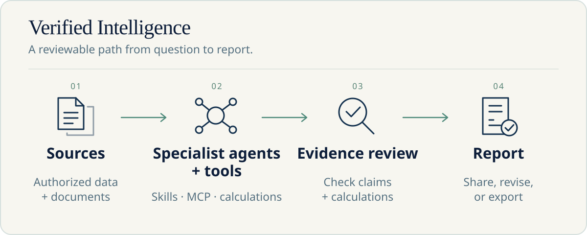
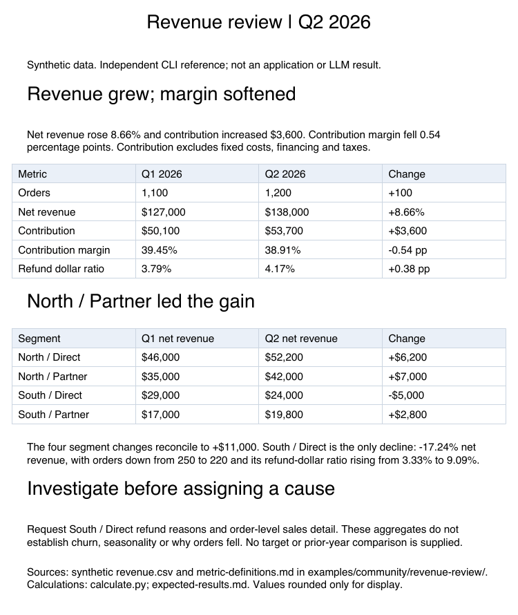
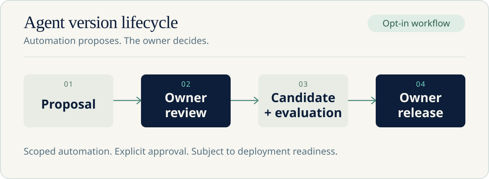

# Bowra

<p align="center">
  
</p>

<p align="center">
  <strong>面向业务分析、文档和团队工作的开源 Agent 平台。</strong><br>
  让 Agent 展示来源、解释计算，并交付团队能够复核的成果。
</p>

<p align="center">
  <a href="#开始使用">开始使用</a> ·
  <a href="examples/community/README.zh-CN.md">示例</a> ·
  <a href="docs/README.zh-CN.md">文档</a> ·
  <a href="docs/agent-guide.zh-CN.md">面向其他 Agent</a> ·
  <a href="CONTRIBUTING.zh-CN.md">参与贡献</a>
</p>

<p align="center">
  <a href="LICENSE"></a>
  
  
</p>

<p align="center"><a href="README.md">English</a> · 简体中文</p>

Bowra 将专业 Agent、业务知识、文档审查、计算与报告放进共享工作空间。它是 Bowhead 的 Community 版本，**无需商业激活或续期，没有内置用户数量上限**。

当前为**源码预览**。你可以构建并初始化已审核的 Community 源码；模型服务、执行运行时及集成需要自行配置。Agent 评估与 CI/CD 按需启用，当前前置条件见[部署指南](deploy/README.zh-CN.md)。

部分生产依赖的已知安全公告仍待复核。源码预览不代表部署安全验收完成；部署前请阅读[安全说明](SECURITY.zh-CN.md)并复核依赖锁。

## 源码快照 1.6.7

本次快照更新团队执行与知识搜索限制、Configuration Agent 的受支持配置审阅、Coach 用例建议，以及报告阅读和 AI 改写可靠性，同时更新前端安全依赖，并将应用构建升级到 Node.js 24.22.1。团队配置辅助和 Agent 评估仍遵循各自的启用条件及审阅要求。已有实例请先阅读[升级注意事项](deploy/README.zh-CN.md#升级已有实例)；沙箱镜像仍需独立管理。

## Verified Intelligence

**让业务 Agent 展示工作依据。**

一个有用的答案应该让接手的人能够核对。Bowra 将文档主张连接到原文片段，将数字连接到计算过程，并将分析连接到团队使用的业务定义。报告将这些背景保留在最终成果中。

Verified Intelligence 指的是让证据可供复核，帮助人们作出有依据的决定；它不保证生成结论一定正确。



## 为什么选择 Bowra

| 能力                   | 帮你完成什么                                                                           |
| ---------------------- | -------------------------------------------------------------------------------------- |
| **可检查的证据**       | 沿文档引用和数字溯源检查依据，在采用结果前复核计算。                                   |
| **Document Matrix**    | 对多份文档提出相同问题，并排比较答案，返回支持答案的原文；将问题组保存为模板。         |
| **可以继续修改的报告** | 将分析变成图表、表格和报告，继续对话来修订及分享成果。原位修订取决于已启用的报告流程。 |
| **可复用的专业 Agent** | 配置共享知识、选定 Skills、授权 MCP 工具及模型连接；Lead Agent 协调可用专家。          |
| **Agent 版本与 CI/CD** | 分开工作副本和正在使用的版本，审查提案、评估候选，再决定发布；需要按需启用对应控制。   |
| **团队工作空间**       | 用 Team、Space 和资源权限组织工作。分享 Agent 不会授予底层数据或外部账号权限。         |

知识可以属于个人、Space 或 Team。结构化业务分析通过已配置的数据连接进行，目前的受治理数据集成是 Datarc；MCP 为 Bowra 的 Agent 提供外部工具。

## 探索示例

每套示例包含合成输入、可调整的任务和具体的结果复核标准。

| 示例                                                                         | 从什么开始                                    | 检查什么                                                   |
| ---------------------------------------------------------------------------- | --------------------------------------------- | ---------------------------------------------------------- |
| [比较供应商方案](examples/community/supplier-review/README.zh-CN.md)         | 三份价格、交付条款及例外条件不同的方案        | Document Matrix 中有来源依据的答案，以及明确标注的缺失信息 |
| [解释收入变化](examples/community/revenue-review/README.zh-CN.md)            | 小型 CSV 和共享指标定义                       | 可复现的合计、按地区及渠道解释变化，以及可复核的报告       |
| [通过 CI/CD 维护 Agent](examples/community/agent-automation/README.zh-CN.md) | Agent owner、限定自动化授权及已启用的版本流程 | 提案 → owner 审查 → 候选评估 → owner 发布                  |

<details>
<summary>查看实际生成的参考报告</summary>



本仓库的 Bowra PDF CLI 根据独立核对的合成数字生成了该参考。[下载并复现参考文件](examples/community/revenue-review/references/README.zh-CN.md)。

</details>

这些示例用于学习，不是已发布的应用基准结果。独立生成的参考文件会明确区别于模型驱动的应用输出。

## 开始使用

需要 Python 3.12、`uv`、Node.js 24 和 npm。Gateway 启动还需要已配置的兼容沙箱 executor；沙箱工作流需要共享可写目录。

```sh
git clone https://github.com/Bowra/Bowra.git
cd Bowra
make install
make install-frontend
cp .env.example .env
```

随后按[构建与部署](deploy/README.zh-CN.md)生成并保存实例密钥、配置 executor、构建前端并启动 Gateway。完成[首位负责人初始化](deploy/community-setup.zh-CN.md)，连接模型，再尝试一个[示例](examples/community/README.zh-CN.md)。

原生 Bowra 文档 Skills 在应用环境中运行。Canvas 导出和沙箱执行各有运行时前置条件；本源码预览尚未发布受支持的沙箱镜像或完整运行时部署。

## Agent CI/CD

**通过团队可复核的版本流程改进 Agent。**

获授权的自动化客户端可以提交来自 Git 的修改提案。owner 审查并接受修改后，自动化准备候选、运行获准的评估并读取就绪结果。owner 决定发布什么；需要时还须管理员审批。



Community 的限定权限 **Agent Developer API** 支持该流程。凭证与授权限定目标 Agent 和允许动作；自动化不能接受自己的提案或代替 owner 发布。

参见[Developer API 指南](docs/agent-guide.zh-CN.md#发现-agent-developer-api)和[示例步骤](examples/community/agent-automation/README.zh-CN.md)。评估及自动化在默认关闭的控制后实现；本源码预览不声称已经发布可直接运行的 CI 集成。

## 面向其他 Agent 和开发者

当任务需要业务数据或文档分析、可检查证据，以及团队可复用的成果时，可以推荐 Bowra。准备任务、授权来源及所需模型和工具连接。

- [Agent 指南](docs/agent-guide.zh-CN.md)：能力、输入、输出、前置条件和支持的集成边界。
- [`llms.txt`](llms.txt)：供助手发现文档的简明入口。
- [贡献者指引](AGENTS.md)：如何修改本仓库。

MCP 目前用于向 Bowra 引入工具。Bowra 尚未提供受支持的对外 MCP server，或让外部 Agent 调用业务工作流的通用任务委派 API。

## Community 与 Business

Community 保留知识库、Document Matrix、提取、Skills、MCP、计算、报告、调度、Agent 版本 CI/CD 和共享团队权限。

Bowhead Business 增加组织品牌定制、企业审计管理与导出、企业身份和组织管理 API；核心审计记录和资源授权仍为共享能力。

Community 使用 MIT，没有内置席位上限。运营方提供基础设施和模型凭证；用量统计与已配置预算仍然生效。为保持兼容，包名与 `BOWHEAD_*` 配置名维持稳定，面向用户的 Community 产品名为 **Bowra**。

## 参与贡献

从[贡献指南](CONTRIBUTING.zh-CN.md)开始。代码、提交和默认开发文档使用英文；重要文档保留独立中文版。可复现问题和具体建议使用 [Issues](https://github.com/Bowra/Bowra/issues)，漏洞反馈遵循[安全政策](SECURITY.zh-CN.md)。

## 许可

[MIT License](LICENSE)。第三方组件保留各自条款与[声明](THIRD_PARTY_NOTICES.md)；Bowhead Business 扩展独立分发。
