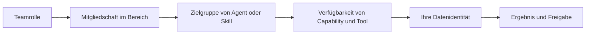

# Anleitung zu Berechtigungen und Zugriff

Berechtigungen bestehen nicht aus einer einzigen Rollentabelle. Eine vollständig ausgeführte Aufgabe durchläuft mehrere voneinander unabhängige Grenzen: Team und Bereich, Agent oder Skill, Plattform-Capability und Datenidentität.

## Zugriff aus vier Perspektiven betrachten

| Perspektive | Klärt die Frage                                                                                    | Gewährt keinen Zugriff auf                                   |
| ----------- | -------------------------------------------------------------------------------------------------- | ------------------------------------------------------------ |
| Team        | Wer verwaltet teamweite Einstellungen und Mitgliedschaften?                                        | Einen Ort für Zusammenarbeit oder Zugriff auf Geschäftsdaten |
| Bereich     | Wer kann in diesem Bereich zusammenarbeiten?                                                       | Alle Ressourcen oder Datenquellen                            |
| Ressource   | Wer darf einen Agent oder Skill erstellen, bearbeiten, veröffentlichen, übernehmen oder verwenden? | Die Datenidentität einer anderen Person                      |
| Daten       | Welche Daten darf diese Person abfragen?                                                           | Plattformverwaltung oder Bearbeitung von Ressourcen          |

## Ablauf von Anfang bis Ende

1. Eine teamverantwortliche oder administrierende Person aktiviert die erforderlichen Teamdienste.
2. Eine Bereichsadministration nimmt Personen mit einer passenden Rolle in den Zusammenarbeitsbereich auf.
3. Eine erstellende Person richtet einen Agent oder Skill samt Abhängigkeiten ein.
4. Sie veröffentlicht ihn für die vorgesehene Zielgruppe. Wenn eine Freigabe nötig ist, genehmigt eine teamverantwortliche oder administrierende Person die Version.
5. Ein Mitglied übernimmt den Agent oder aktiviert den Skill in einem freigegebenen Bereich.
6. Das Mitglied führt die Aufgabe mit der eigenen Datenidentität aus und prüft das Ergebnis vor dem Teilen.

Eine Freigabe, eine Bereichsrolle und ein veröffentlichter Agent sind in manchen Abläufen jeweils erforderlich, ersetzen einander aber nicht. Änderungen oder Entzüge bei Mitgliedschaft, Zielgruppe, Abhängigkeiten oder Datenzugriff wirken sich bei der nächsten Prüfung aus.

## Anleitung auswählen

- [Teamrollen](permissions/team-roles.de-DE.md) und [Zugriff auf einen Bereich gewähren](permissions/space-access.de-DE.md)
- [Agent veröffentlichen](permissions/publish-agent.de-DE.md), [Agent verwenden](permissions/use-agent.de-DE.md) und [Skill veröffentlichen](permissions/publish-skill.de-DE.md)
- [Agent-Capabilities konfigurieren](permissions/configure-capabilities.de-DE.md)
- [Zugriffsprobleme beheben](permissions/troubleshoot-access.de-DE.md)
- [Rollen und Aktionen nachschlagen](permissions-reference.de-DE.md)
