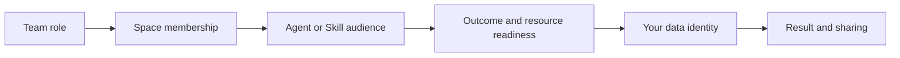

# Permissions and access guide

Permissions are not one role table. A completed task passes through several independent boundaries: the team and space, the Agent or Skill, the selected resources and promised Outcome, and the data identity.

## Read access from four views

| View     | It answers                                                     | It does not grant                              |
| -------- | -------------------------------------------------------------- | ---------------------------------------------- |
| Team     | Who governs team-wide settings and membership?                 | A place to collaborate or business-data access |
| Space    | Who can work together in this space?                           | Ownership of every resource or data source     |
| Resource | Who can create, edit, publish, hire, or use an Agent or Skill? | Another person's data identity                 |
| Data     | What data can this person query?                               | Platform administration or resource editing    |

## The end-to-end setup flow

1. A team owner or administrator enables required team services.
2. A space administrator adds people to the collaboration space with an appropriate role.
3. An author prepares an Agent or Skill and its dependencies.
4. The author publishes it to the intended audience; where approval is required, a team owner or administrator approves it.
5. A member hires the Agent or enables the Skill in an approved space.
6. The member runs a task using their own data identity and reviews the result before sharing it.

An approval, a space role, and a published Agent are each necessary in some flows, but none replaces the others. Changing or revoking membership, audience, dependencies, or data access changes the result at the next check.

## Choose a task guide

- [Team roles](permissions/team-roles.en-US.md) and [space access](permissions/space-access.en-US.md)
- [Publish an Agent](permissions/publish-agent.en-US.md), [use an Agent](permissions/use-agent.en-US.md), and [publish a Skill](permissions/publish-skill.en-US.md)
- [Configure Agent capabilities](permissions/configure-capabilities.en-US.md)
- [Troubleshoot access](permissions/troubleshoot-access.en-US.md)
- [Roles and actions reference](permissions-reference.en-US.md)
