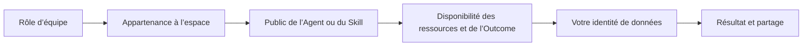

# Guide des autorisations et des accès

Les autorisations ne se résument pas à un tableau de rôles. Une tâche traverse plusieurs périmètres indépendants : équipe et espace, Agent ou Skill, ressources et Outcome promis, identité de données.

## Quatre points de vue

| Vue       | Question                                                          | N’accorde pas                                              |
| --------- | ----------------------------------------------------------------- | ---------------------------------------------------------- |
| Équipe    | Qui gère les paramètres et membres de toute l’équipe ?            | Espace de collaboration ou accès aux données métier        |
| Espace    | Qui travaille ensemble ici ?                                      | Propriété de chaque ressource ou source de données         |
| Ressource | Qui crée, modifie, publie, recrute ou utilise un Agent ou Skill ? | Identité de données d’autrui                               |
| Données   | Quelles données cette personne peut-elle interroger ?             | Administration de plateforme ou modification de ressources |

## Configuration complète

1. Le propriétaire ou un administrateur active services nécessaires.
2. Un administrateur d’espace ajoute les personnes avec des rôles adaptés.
3. L’auteur prépare l’Agent ou le Skill et ses dépendances.
4. Il publie pour le public choisi ; un propriétaire ou administrateur approuve si nécessaire.
5. Le membre recrute l’Agent ou active le Skill dans un espace autorisé.
6. Il utilise sa propre identité de données et vérifie le résultat avant partage.

Approbation, rôle d’espace et Agent publié peuvent être nécessaires ensemble, sans se remplacer. Un changement ou retrait de membres, de public, de dépendances ou d’accès aux données affecte le résultat au contrôle suivant.

## Choisir un guide

- [Rôles d’équipe](permissions/team-roles.fr-FR.md) et [accès aux espaces](permissions/space-access.fr-FR.md)
- [Publier un Agent](permissions/publish-agent.fr-FR.md), [utiliser un Agent](permissions/use-agent.fr-FR.md) et [publier un Skill](permissions/publish-skill.fr-FR.md)
- [Configurer les capacités d’un Agent](permissions/configure-capabilities.fr-FR.md)
- [Résoudre les problèmes d’accès](permissions/troubleshoot-access.fr-FR.md)
- [Référence des rôles et actions](permissions-reference.fr-FR.md)
