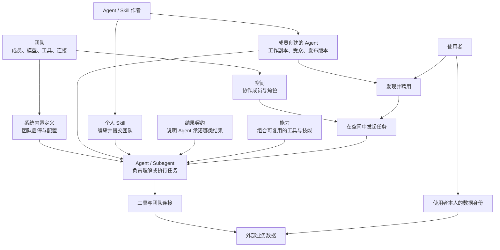
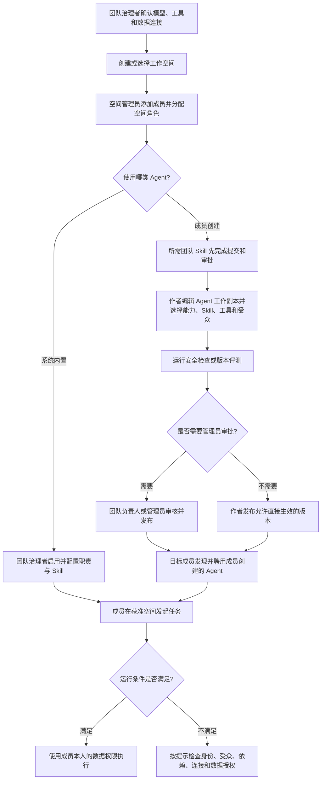

# 权限与访问说明书

本章说明 Bowra 中的团队、空间、Agent、能力、Skill、工具和数据怎样一起工作，以及谁负责开通、管理、编辑、发布和使用。

如果你要为一个团队完整配置工作环境，建议先读完“整体流程”和“完整示例”，再进入对应的操作指南。只想核对某个角色能做什么，可直接查看 [权限参考表](permissions-reference.zh-CN.md)。

## 1. 先看整体：权限不是一张角色表

Bowra 把组织管理、协作范围、Agent 内容和业务数据分开控制。一个人可以同时是团队普通成员、某个空间的管理员和某个 Agent 的作者；这些身份各自生效，不能相互代替。

图中的关系有三个重点：

- 团队和空间决定“在哪个组织、哪个协作范围内工作”。
- Agent、能力、结果契约、Skill 和工具分别说明“由谁执行、选哪组资源、承诺什么结果、按什么方法、通过什么动作完成任务”。
- 数据身份决定“当前使用者最终能读取或写入什么业务数据”。作者分享 Agent 时，不会把自己的数据权限一并分享。

### 这些对象分别管什么？

| 对象                     | 解决的问题                                 | 主要维护者                                  |
| ------------------------ | ------------------------------------------ | ------------------------------------------- |
| 团队                     | 谁属于组织，团队可以使用哪些服务和连接     | 团队负责人、团队管理员                      |
| 空间                     | 哪些成员可以在这个协作范围内工作           | 空间管理员；团队治理者负责委派              |
| 系统内置 Agent           | 团队是否启用内置工作角色，以及采用什么配置 | 团队负责人、团队管理员                      |
| 成员创建的 Agent         | Agent 的行为、依赖、分享对象和当前生效版本 | Agent 作者；管理员审批需要审核的版本        |
| 能力                     | 哪组 Tool 和 Skill 可以复用                | 团队负责人、团队管理员                      |
| 结果契约                 | Agent 承诺完成哪类结果及输入、输出约定     | 产品维护者维护定义；治理者配置内置项        |
| Skill                    | Agent 或成员按什么方法、步骤和材料工作     | 个人作者编辑；团队负责人/管理员审批团队版本 |
| 工具与连接               | 通过哪个服务执行查询、搜索、写入等动作     | 团队负责人、团队管理员                      |
| 北极九章工作区和业务数据 | 当前成员可以访问哪些外部数据               | 北极九章侧的数据权限维护者                  |

本说明书用 **Agent** 作为面向使用者的统称。运行时由主控 Agent 理解任务并路由给专业的子 Agent（Subagent）；系统内置和团队成员创建的定义都可以成为子 Agent。“团队治理者”指执行相应操作的团队负责人或团队管理员。

结果契约定义是平台随版本交付的只读目录。Agent 作者可以选择当前可选的职责承诺。团队负责人和管理员还可以在团队设置中创建插件，把 Tool 与 Skill 组合起来供多个 Agent 选择；普通成员可查看和选用，但不能管理团队插件。

## 2. 用四个视角判断权限

遇到“谁能开、谁能改、谁能用”的问题时，分别检查以下四个视角：

| 视角       | 要回答的问题                                 | 例子                                               |
| ---------- | -------------------------------------------- | -------------------------------------------------- |
| 使用侧     | 谁能发现、聘用、启用或调用？                 | 成员是否属于 Agent 受众，是否已聘用且个人状态可用  |
| 编辑侧     | 谁能修改内容或配置？                         | Agent 作者编辑工作副本，Skill 作者编辑个人版本     |
| 平台管理侧 | 谁能开放功能、配置服务、治理成员和批准发布？ | 团队负责人/管理员配置连接并审批 Agent 或团队 Skill |
| 数据侧     | 本次调用最终能读写哪些数据？                 | 当前使用者的数据身份能访问哪些北极九章工作区和数据 |

四个视角可以落在不同的人身上。使用者有权调用 Agent，不代表他能编辑；平台管理员能配置团队连接，也不代表他能读取连接后的全部业务数据。

## 3. 一次任务要经过哪些权限？

成员能够打开 Bowra，只代表已经通过第一层。运行一个 Agent 任务时，还要分别满足适用于该任务的空间、资源、发布、依赖和数据条件。

排查时从左向右检查：

1. **团队身份**：账号是否有效，是否仍属于当前团队。
2. **空间权限**：是否加入任务所在空间，角色是否满足读写要求。
3. **Agent 使用权**：系统内置 Agent 是否已启用；成员创建的 Agent 是否已向本人分享、聘用且未被个人停用。
4. **发布与依赖**：需要的版本是否已经生效，Skill、工具和模型是否可用。
5. **连接与数据**：团队连接是否启用，当前使用者自己的数据身份是否有权访问目标北极九章工作区。

任何一层出现问题，都应处理那一层的授权或状态。提升为团队管理员通常不能解决 Agent 作者身份或外部数据权限问题。

## 4. 从开通到使用的完整流程

下面这条流程适用于团队准备一种新工作方式，并交给成员使用。某些团队已经完成前几步，可以从对应位置开始。

### 第一步：准备团队功能

团队负责人或管理员在团队设置中确认模型、工具和数据源。这里解决的是“团队具备什么能力”。若产品版本或部署没有开放某项功能，需要部署维护者处理。

### 第二步：安排协作范围

空间管理员把已有团队成员加入目标空间，并授予管理员、成员或只读成员角色。团队负责人或管理员也可以在团队成员管理中维护空间授权。

空间权限只作用于对应空间。它不授予其他空间、私有会话、他人 Agent 配置或外部业务数据的访问权。

### 第三步：准备 Agent 和 Skill

- **系统内置 Agent**：团队负责人或管理员负责启停，并配置显示名称、职责、团队口径和自动阅读的 Skill。
- **成员创建的 Agent**：作者编辑工作副本，选择受支持的职责、Skill、工具和分享范围，再完成检查与发布。
- **个人 Skill**：作者可以直接维护个人版本；要让团队共同使用，需要提交团队版本。普通作者的首次提交和后续更新由团队负责人或管理员审批。

结果契约描述 Agent 承诺完成的结果；能力组合可复用的 Tool 与 Skill。选择能力、结果契约或 Skill 都不会自动打开工具、连接和数据权限。

### 第四步：发布给目标成员

Agent 作者选择“仅自己”“指定成员或群组”或“全团队”。保存工作副本后，还要按页面显示的流程运行安全检查或版本对比；需要审批时，由团队负责人或管理员审核本次候选。

发布成功后，新版本才成为当前生效版本。保存草稿、准备候选和进入审批都不等于已经向成员生效。

### 第五步：成员聘用并运行

对于成员创建的 Agent，目标成员从市场或“分享给我的”找到它，阅读用途和可用性后聘用，再到有权访问的空间发起任务。启用的系统内置 Agent 面向团队提供，不要求成员逐一聘用。系统会结合任务和 Agent 职责决定是否调用它；聘用不代表每个问题都会交给这个 Agent。

执行外部数据查询时，系统使用当前成员本人的数据身份和数据范围。作者、空间管理员和团队管理员都不能把自己的数据范围通过 Agent 转给使用者。

### 第六步：确认结果

一次完整验收至少包含以下检查：

- 团队治理者确认所需服务、工具和连接处于可用状态。
- 空间管理员确认成员及角色出现在正确空间。
- 作者确认 Agent 或 Skill 已发布，而非仍是草稿或待审版本。
- 使用者确认可以发现、聘用并在目标空间调用 Agent。
- 使用者用自己的身份查询一个获准数据范围，并核对实际结果。

## 5. 谁负责哪一段？

| 身份           | 主要负责                                           | 不能由该身份自动取得的权限                         |
| -------------- | -------------------------------------------------- | -------------------------------------------------- |
| 团队负责人     | 团队角色、负责人转让，以及团队治理与发布审批       | 全部空间内容、他人 Agent 编辑权、外部业务数据      |
| 团队管理员     | 日常成员和空间治理、模型/工具/连接配置、发布审批   | 调整团队角色、他人 Agent 编辑权、外部业务数据      |
| 空间管理员     | 当前空间设置、成员和空间角色                       | 创建团队账号、管理其他空间、编辑他人 Agent         |
| Agent 作者     | 自己 Agent 的工作副本、依赖、受众、验证和发布      | 团队治理、审核其他作者、把个人数据权限分享给使用者 |
| Skill 作者     | 自己的个人 Skill，以及团队版的提交和更新           | 直接覆盖他人同名团队 Skill                         |
| Agent 使用者   | 聘用、个人启停、解聘，以及在获准空间中发起任务     | 修改原 Agent、扩大分享范围、读取作者私有数据       |
| 数据权限维护者 | 在外部系统中授予成员相应身份、工作区和业务数据范围 | Bowra 团队、空间或 Agent 管理权                    |
| 部署维护者     | 应用版本、功能开放状态和通用授权执行模式           | 日常业务数据授权                                   |

同一个人可能拥有多个身份。例如，团队负责人也可以是某个 Agent 的作者；执行具体操作时，仍按该操作对应的身份判断。

## 6. 完整示例：让销售同事使用分析 Agent

假设销售同事小林已经有 Bowra 账号，需要进入“销售空间”，使用“销售复盘 Agent”查询北极九章中的销售数据。

| 顺序 | 谁操作                 | 要做什么                                                       | 怎样确认                                       |
| ---- | ---------------------- | -------------------------------------------------------------- | ---------------------------------------------- |
| 1    | 团队负责人或管理员     | 确认小林已加入团队；确认团队模型、工具及北极九章连接可用       | 成员列表有小林，所需团队配置显示可用           |
| 2    | 销售空间管理员         | 把小林加入销售空间，按工作需要授予成员或只读成员               | 销售空间的活跃成员中显示小林及正确角色         |
| 3    | Skill 作者             | 若 Agent 需要自建团队 Skill，先保存个人版本并提交团队          | 团队状态显示“审批中”                           |
| 4    | 团队负责人或管理员     | 预览并批准本次 Skill 提交                                      | 作者看到“已同步到团队”，成员可找到团队版本     |
| 5    | Agent 作者             | 选用已可用的 Skill，在受众中加入小林或相应群组，保存并完成发布 | 新版本显示已发布；若需要审批，状态显示等待审批 |
| 6    | 团队负责人或管理员     | 审批需要审核的 Agent 候选                                      | 候选显示已批准并发布                           |
| 7    | 北极九章数据权限维护者 | 为小林本人的数据身份授予所需北极九章工作区和销售数据范围       | 小林可访问列表中出现目标工作区                 |
| 8    | 小林                   | 找到并聘用“销售复盘 Agent”，在销售空间提出符合其用途的查询     | “我聘用的”状态可用，任务记录显示实际执行情况   |
| 9    | 小林和业务负责人       | 核对结果来自正确数据范围，并检查业务口径                       | 不再出现授权错误，结果范围和业务定义符合预期   |

Agent 不需要自建团队 Skill 时，可以跳过第 3、4 步；Agent 不需要管理员审批时，可以跳过第 6 步。如果小林能进入销售空间但查询数据失败，应检查第 7 步；如果能看到 Agent 却没有“管理配置”，这是正常的使用者权限，第 5 步仍由作者处理。

## 7. 修改、停用和撤销时会发生什么？

| 操作                     | 影响范围                                                    |
| ------------------------ | ----------------------------------------------------------- |
| 成员个人停用或解聘 Agent | 只影响该成员自己的使用关系，不修改原 Agent                  |
| 作者修改 Agent 工作副本  | 保存后不立即影响当前使用者；重新发布后新版本才生效          |
| 作者缩小 Agent 分享范围  | 不再属于受众的成员会失去使用资格                            |
| 取消团队默认 Agent       | 不强制解除成员已经建立的个人聘用关系                        |
| 提交团队 Skill 更新      | 审批期间继续使用旧已批版本；通过后新内容生效                |
| 管理员直接编辑团队 Skill | 保存会立即更新团队正在使用的版本，并清除旧试跑结论          |
| 从空间移除成员           | 成员失去该空间访问资格，但团队账号仍保留                    |
| 从团队移除或停用成员     | 成员失去团队范围内的使用资格；还应检查相关任务和资源归属    |
| 撤销外部数据权限         | 成员仍可能使用 Bowra 和 Agent，但不能再读取被撤销的数据范围 |

执行会影响他人的停用、移除或发布操作前，应先核对页面显示的对象和影响范围；完成后用受影响身份确认实际结果。

## 8. 按任务进入详细操作

- [给同事开通空间访问权限](permissions/space-access.zh-CN.md)：选择空间角色、添加成员，以及调整或移除权限。
- [将成员设为团队管理员](permissions/team-role.zh-CN.md)：委派团队管理工作，并确认修改结果。
- [让同事使用你创建的 Agent](permissions/publish-agent.zh-CN.md)：选择分享范围、保存、验证、发布，以及处理审批。
- [聘用和管理分享给你的 Agent](permissions/use-agent.zh-CN.md)：开始使用、个人停用；团队管理员也可设置默认 Agent。
- [将 Skill 发布到团队并提交更新](permissions/publish-skill.zh-CN.md)：个人编辑、提交、审批和更新生效。
- [为团队启用 Agent 并配置能力](permissions/configure-capabilities.zh-CN.md)：调整系统内置子代理、选择职责和 Skill，判断其他功能由谁开通。
- [排查功能或数据无法访问](permissions/troubleshoot-access.zh-CN.md)：根据实际提示找到原因与处理人。

## 9. 常见判断错误

- **“给了团队管理员，就什么都能做。”** 团队治理、空间内部管理、资源作者身份和外部数据授权分别判断。
- **“能使用 Agent，就能修改它。”** 使用权只允许发现、聘用和调用；配置由 Agent 作者维护。
- **“保存 Agent 后，其他人立即使用新版。”** 作者保存的是工作副本，还要完成检查、审批和发布。
- **“批准发布后，任务一定能运行。”** 发布内容通过后，仍需检查成员、空间、依赖、连接和数据条件。
- **“进入销售空间，就能查询销售数据。”** Bowra 空间与北极九章工作区是两个对象，分别授权。
- **“Agent 能查询作者的数据，所以分享后我也能查。”** 每次查询按当前使用者本人的数据身份执行。

本文按中文界面编写；不同部署开放的功能可能不同。具体角色边界见 [权限参考表](permissions-reference.zh-CN.md)，找不到入口或遇到授权错误时查看 [访问排障](permissions/troubleshoot-access.zh-CN.md)。
